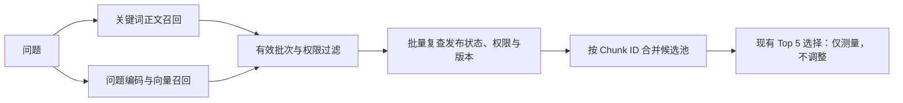

# 召回层排查与中文关键词优化：2026-11-10

本轮改善了候选池召回和查询开销，但没有通过冻结验证组的全部阈值，因此召回层尚未验收，不进入重排、上下文组装或答案生成优化。最小开发预算 10 在验证组失效；现行 Top 5 的每路 15 条预算也有流程改写漏召回，保留现行候选策略。

## 评测边界与溯源

使用 134 篇合成文档：原始 14 篇与 120 篇模拟业务干扰资料，实际索引产生 136 个 Chunk。原始 14 篇正文和 40 道题的事实、原文证据均未改变。新增 40 道冻结的新措辞题，与原题使用同一批事实，由同一助手编写；它们不是独立真实用户盲测。干扰资料是模板化压力语料，不能代表真实知识库规模或分布。

每个开发矩阵实际调用 40 题 × 5 档预算；验证组实际调用 40 题 × 2 档预算。每组含 36 道可回答题和 4 道无答案题，召回均只对可回答题宏平均。只有开发组用于选方案；[selection.json](../selection.json) 在首次执行验证组前提交，冻结了 CJK、空向量任务前缀、最小预算 10 和现行预算 15 两组验证配置。

[机器可读快照](recall-audit-v2.json) 保留每轮提交、干净工作区标识、语料 SHA-256、模型摘要、各路与候选池分数、题型结果、10/15 预算逐题损失和阶段耗时。全部使用同一 `nomic-embed-text` 模型摘要、768 维、1000/150 分块配置，重排规则保持固定。原始逐候选正文和 API 日志保留在快照标注的本机 `reports/` 目录，不提交 Token 或用户数据。

## 发现与改动

1. 原来的 standard analyzer 把“上传成功”拆成“上、传、成、功”，相似业务资料容易凭共有单字获得较高分。增加内置 `cjk` 多字段，以相邻双字召回，保留原来的 standard 字段用于迁移和回退。没有为题目硬编码答案、文档 ID 或查询扩展。
2. 问题向量使用 `embedQuery`，正文使用 `embedDocuments`。另测正文 `search_document: `、问题 `search_query: ` 的任务前缀，但单独改前缀仍未通过召回阈值，默认保持空前缀。这两个 Ollama 入口在空前缀时底层等价，拆分合约本身不是质量提升。
3. 候选文档元数据原先逐个读取，改为一路一次批量查询，重新应用发布状态与用户可见范围，再按原候选顺序核对版本。索引映射改为每个进程实例、每个索引只初始化一次；失败后清除初始化 Promise，允许后续重试。
4. 内部诊断记录原始候选、路由输出、合并池和最终选择，并分解权限范围、编码、索引与元数据复查耗时。公开接口仍只返回经过复查的正文，没有公开调试路由。

## 开发组结果

下表都是每路 15 条、最终选择固定 Top 5，不能将候选池证据召回当成最终接口或答案正确率。

| 配置                 | 关键词证据 | 向量证据 | 合并池证据 | 最终 Top 5 证据 | 内部串行 P95 ms |
| -------------------- | ---------: | -------: | ---------: | --------------: | --------------: |
| 原始编码、standard   |     93.06% |   61.11% |     93.06% |          61.11% |          646.38 |
| 仅任务前缀、standard |     93.06% |   65.28% |     94.44% |          63.89% |           79.74 |
| CJK 首轮             |       100% |   61.11% |       100% |          61.11% |          843.89 |
| CJK 分段计时轮       |       100% |   61.11% |       100% |          61.11% |          331.03 |
| CJK + 查询开销优化   |       100% |   61.11% |       100% |          61.11% |          206.99 |

初始 CJK 轮的性能门槛失败保留在快照中，没有删除失败轮或放宽 500 ms 阈值。不同运行时刻的编码耗时和系统负载差异明显，不能把前缀轮的低延迟归因于前缀，也不能从这些单机串行运行推断生产性能。分段计时显示，15 条预算的元数据复查平均约 32–34 ms，优化轮约 4–5 ms；索引段约 44–48 ms，优化轮约 31–35 ms。组合优化的前后对照不能分别证明每项优化的独立因果收益。

| 优化后每路预算 | 合并池证据 | 全部来源命中 | 全部证据完整 | P95 ms | 开发质量与串行门槛 |
| -------------- | ---------: | -----------: | -----------: | -----: | ------------------ |
| 5              |     93.06% |       97.22% |       91.67% | 262.17 | 失败               |
| 10             |     98.61% |         100% |       97.22% | 208.65 | 通过               |
| 15             |       100% |         100% |         100% | 206.99 | 通过               |
| 30             |       100% |         100% |         100% | 265.61 | 通过               |
| 60             |       100% |         100% |         100% | 313.15 | 通过               |

按冻结协议，开发组选择最小通过预算 10；这不是给所有 Top K 或所有知识库设置通用预算的证据。业务接口仍沿用原来 3K、每路最多 60 的策略，Top 5 对应每路 15。

## 冻结新措辞验证：未通过

| 每路预算 | 合并池证据 | 全部来源命中 | 流程类证据（6 题） | 最终 Top 5 证据 | P95 ms | 结果             |
| -------- | ---------: | -----------: | -----------------: | --------------: | -----: | ---------------- |
| 10       |     94.44% |       94.44% |             66.67% |          43.06% | 226.10 | 总体与流程题失败 |
| 15       |     97.22% |       97.22% |             83.33% |          43.06% | 182.56 | 流程题失败       |

协议要求总体证据与全部来源命中至少 95%、每个正样本题型证据至少 85%。15 条预算虽然总体通过，但流程类 5/6 命中为 83.33%，不能四舍五入为达标。

`val017`：“解析尚未成功的草稿能申请发布审批吗，最终由什么角色批准？”原文使用“提交审核”“管理员负责审核通过或驳回”。正确证据在索引中完整存在，却没有进入两路原始候选，属于召回失败，不是分块遗漏、合并丢失或重排丢失。没有根据这条验证题追加答案词、改标注或重新调预算。

验证结果已被查看，后续若据此做流程术语扩展，这组题只能继续作为回归题，不能再当作未见验证。需要新的独立问题保留组，最好由实际使用者编写并标注来源。

最终 Top 5 的 43.06% 还表明：正确候选已在池中也会被原规则选择淘汰。该现象仅记录为后续层的已知问题，本轮没有修改融合权重、重排、上下文或答案逻辑。四道无答案题仍会得到候选；本轮没有评价拒答与回答真实性。

## 迁移与下一轮召回工作

默认 `RAG_KEYWORD_ANALYZER=standard`，本轮已实现的 CJK 优化需部署后显式启用。先保留 standard 查询、重建全部当前发布文档的 RAG generation，确认激活，再统一切至 `cjk`。新增多字段不会自动补齐旧记录的词项，不能直接改配置后认为完成升级。回退查询配置无需删索引。具体边界见 [检索设计](../../../docs/retrieval.md)。本轮没有操作用户业务索引或业务存储卷。

下一轮仍然停留在召回层：用开发/回归题比较中文或多语言 Embedding；检查流程领域术语归一化或受控查询扩展的收益和误召回；再用新的独立保留组验证。`bge-m3` 下载曾因速度过慢中止，没有完成该模型对照，不能宣称已完成中文模型选型。也尚缺真实用户问题、非 Markdown 解析质量与并发负载验证，当前 136 个 Chunk 不能支持“大规模知识库已验收”的结论。

## 代码验证与默认配置回归

- API 全量 210 项、前端 11 项、Node 评测工具 14 项、Python 项目评测 19 项与适配器 11 项测试通过。
- 真实 PostgreSQL / Elasticsearch / Neo4j 的 15 项索引一致性测试以 CJK 模式运行通过，包含旧字段迁移、暂存批次、发布状态、权限与修订过滤；真实 RabbitMQ 投递可靠性 7 项测试通过。测试健康检查以 broker 用户运行，修复首次启动时 root 诊断可能创建不可读 Erlang cookie 的竞态。
- API 与前端构建、修改文件格式检查、Python Black 和 Compose 配置验证通过。前端仍有既有的大 bundle 提示，本轮未修改前端代码。
- 原始 14 篇 / 40 题、3 模式 × K=1/3/5 的 360 次默认配置 HTTP 回归完成，9 组全部质量指标与上一轮实验 B 一致。配置、来源与摘要见 [v1-regression.json](v1-regression.json)。该轮元数据如实标注工作区 dirty，原因是待提交的实验报告与结果文件，运行应用源码已提交，没有在测量期间更改。
- 各轮状态为 completed；3 次 RabbitMQ 启动失败未计分，并在诊断日志保留可读的失败原因。临时基建及卷均清理，未运行图谱抽取或答案生成。

代码检查通过只说明改动的工程行为符合测试；冻结新措辞验证失败仍然成立，不应将本报告视为召回层已完成验收。
