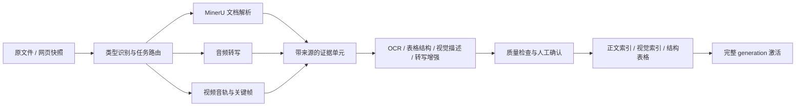

# 多格式接入与多模态知识入库方案

本文记录当前文档入库能力及后续设计。除“本次落地”明确列出的项目，其余均为待实施能力，不能据此宣称音视频、URL 抓取或视觉检索已上线。当前解析、任务恢复、缓存和发布规则分别以 [MinerU 接入](mineru-ingestion.md)、[入库流程](ingestion.md) 和 [管线协议](pipeline.md) 为准。

## 格式接入与内容理解分别验收

核对已安装的 MinerU 4.2.3 `mineru/filetypes.py` 和 Office/HTML 后端发现，它已原生支持 `.doc/.xls/.ppt`、HTML，还有 CSV/TSV、RTF、ODF、EPUB 等格式。此前项目只开放六格式与部分图片 API，不能把应用未接入解释为工具不支持。此次只开放并回归用户提出的旧 Office、静态 HTML，以及已有图片入口；不自动开放工具声明的所有后缀。

| 输入                       | 接入路线                                           | 当前状态与边界                                  |
| -------------------------- | -------------------------------------------------- | ----------------------------------------------- |
| PDF、DOCX、XLSX、PPTX      | MinerU；TXT/MD 本地解析                            | 已有能力                                        |
| DOC、XLS、PPT              | 原始二进制直接发送 MinerU Flash                    | 本次落地；生产不依赖 LibreOffice 转换           |
| HTML、HTM 文件             | 静态 HTML → MinerU Flash → 有序结构/Markdown       | 本次落地；不执行 JavaScript，缺失图片标记待确认 |
| PNG、JPG、JPEG、WebP       | 既有 MinerU OCR 路由                               | 本次开放网页上传；图像内容理解尚未启用          |
| 网页 URL                   | 受控抓取 → 固定快照 → HTML 解析；必要时浏览器渲染  | 待实施；不能将 HTML 文件上传等同于 URL 导入     |
| MP3、WAV、M4A、FLAC 等音频 | 解码 → 语音区段 → 带时间戳转写 → 可选说话人分离    | 待实施；MinerU 不提供本项目所需的 ASR 路由      |
| MP4、MOV、WebM 等视频      | 音轨转写 + 场景/幻灯片关键帧 + 视觉理解 → 时间对齐 | 待实施；只有转写不能完整覆盖视频信息            |

旧 Office 与 HTML 始终请求 Flash，PDF/图片仍按 `MINERU_TIER` 选择档位。显式设置原生引擎时，不宣称支持这些新增格式。网页上传白名单按默认 MinerU 部署提供；切换为原生引擎时，新增格式会在 API 验证阶段被拒绝。

HTML 文件由引擎做静态结构解析，不能保证自动去掉所有导航/广告，也不能读取运行 JavaScript 后才出现的正文。外链及未嵌入图片不自动下载：正文显示缺失提示，质量标记 `needs_review`；原始文件与原始解析 JSON 保留引用供核对。包内图片仍按已有对象存储和补偿规则处理。不要直接把不可信 HTML 放进页面执行。

## 共同中间层：原始证据、结构数据与派生描述

当前 `ParsedDocument` 主要为 Markdown、正文块及来源区段；`SourceLocation` 有页码、幻灯片、工作表/行范围及 bbox，已有 `table-v1` 单元格模型与表内逻辑行号，尚无音视频时间段或通用视觉证据类型。当前 ES `ingestion` 对象仅保留元数据，不参与搜索；现有引用响应也不会自动展示其中所有字段。多模态能力需要扩展契约和引用端，不能只增加扩展名或保存一句模型摘要。

目标数据链路：



建议新增独立、带 schema 版本的证据产物，而不是不断把字段塞入通用段落字符串。概念示例（本次未新增运行时类型）：

```ts
type EvidenceUnit = {
  id: string;
  documentId: string;
  contentId: string;
  revision: number;
  kind: 'text' | 'image' | 'table' | 'audio_segment' | 'video_scene';
  artifactIds: string[];
  source: {
    page?: number;
    slide?: number;
    bbox?: number[];
    startMs?: number;
    endMs?: number;
    sheet?: string;
    cellRange?: string;
    snapshotId?: string;
    elementAnchor?: string;
  };
  representations: Array<{
    kind:
      | 'native_text'
      | 'ocr'
      | 'transcript'
      | 'visual_description'
      | 'table_summary';
    text: string;
    producer: string;
    producerRevision: string;
    sourceArtifactIds: string[];
    review: 'accepted' | 'needs_review';
  }>;
};
```

原始文件、页/图裁剪、音频片段、视频帧、表格单元格和机器描述之间必须有可追溯引用。Markdown 是可读视图；模型描述是派生产物，不能覆盖 OCR、原始转写或数值单元格。用户手工修订后保存新修订，不能继续声称修订文字有原始的精确字节/单元格/时间位置。

解析任务可继续复用 PostgreSQL/Outbox/租约与版本 fencing；音视频和视觉增强应拆成可重试阶段，以阶段产物为断点恢复。不同提供方需要各自任务引用，现有单一 `remote_task_id` 只用于 MinerU，不能同时拿来标识 ASR 和视觉任务。最终只激活满足必需阶段质量要求的完整产物，避免把部分视觉/转写结果标成整份文档已完整处理。

## 图片、图表和流程图

优先做“文字可检索且可以回看原图”，随后再加视觉向量：

1. 保存原图/裁剪图、所属文档修订、页码和 bbox；同时保留邻近标题、图注、上下文。
2. OCR 提取可见文字；视觉语言模型生成可核对的描述。流程图提取节点和有方向的边，图表提取坐标轴、图例、单位和有证据支持的数值。原生 Office 图表可读取底层数据时优先保留底层数据。
3. OCR、图注、上下文和派生描述分别保存，形成关联到同一图片证据的文本索引。模型不能看清的数字或箭头方向保留未知/待确认，禁止用摘要补齐猜测。
4. 第二阶段引入图文共享空间的 embedding，支持“查找包含某种结构的架构图”。单独建立视觉索引，固定模型修订；不能把视觉向量直接写入当前 `nomic-embed-text` 的 768 维文本空间，即使维度相同也不兼容。
5. 检索消费端将文字与视觉候选融合、去重，必要时看原图复核，回答引用对应图片/页码。权限、文档修订和 generation 过滤必须覆盖两类索引及资源访问。

工具选型：MinerU 负责版面/OCR 与资源提取，单独的 VLM 适配器负责图像语义。可评估本地 Qwen-VL 系列等 VLM，但需先验证目标硬件、接口、实际 OCR/图表效果；不要把已安装的纯文本 Qwen 模型当成视觉模型。是否直接启用 MinerU 图像分析应与独立 VLM 增强比较，避免重复调用。当前 Flash 加 `--disable-image-analysis` 的服务仍是原有行为。

## 音频

建议自托管优先，先在固定中文/英文语料上比较 faster-whisper、FunASR 等候选，再选择具体版本/模型；提供方由适配器隔离，也可显式配置云 ASR。未配置对应提供方时，上传入口不宣称可解析；不会因配置缺失自动将文件送往云服务。

流程为解码/探测 → 静音与语音区段识别 → 时间戳转写 → 可选说话人分离 → 分段证据。FFmpeg/ffprobe 负责媒体解码和探测；ASR 负责转写，两者不能互相替代。

- 保存原音频、分段起止时间和原始转写；需要词级定位时增加对齐阶段。ASR 输出无可靠词时间戳时，只承诺段级引用。
- 说话人分离先记 `speaker_1` 等编号，不自动推断真实身份。会议角色/姓名需要可信外部标注或人工确认。
- 按话题与说话人边界组织 Chunk，并保留时间范围；长录音采用有界窗口和边界对齐，合并重叠转写，避免漏词或重复。
- 专有名词可用热词或校对辅助，但保留原始转写和改动记录。纠错/摘要不能成为唯一检索正文，也不能编造录音中没有的内容。
- 语音以外的音乐/警报/机械声不属于普通 ASR 的完整理解范围；有这类业务需求时新增声音事件分类产物，并单独评测。
- 检索结果至少能跳到对应秒数回听。摘要只作为派生导航，事实回答应可回溯到实际片段。

## 视频

先复用音频链路，再补画面；目标是同时检索“讲了什么”和“画面出现了什么”。

- 提取音轨转写；根据场景切换、幻灯片/屏幕内容变化挑选关键帧，去除近重复帧，并设最大帧数/分钟预算。单纯每秒截一张不能可靠覆盖短暂出现的文字，也可能对静态会议重复计费。
- 帧做 OCR 和视觉描述；会议视频、操作演示、讲座、无声画面分别制定抽帧和覆盖规则。窗口切换/鼠标操作关系不能只靠一张静态帧概括。
- 根据时间范围关联转写与关键帧，保留两个来源；不能将同一时段出现的无关文字强行解释成讲话者说过的话。
- 以场景/主题组织知识单元，保存起止时间、关键帧证据和原视频位置；无音轨视频仍可走视觉链路，音轨或画面处理失败应分别可见。
- 检索答案能跳转原视频对应时间，并显示用于回答的关键帧。音画同步、短暂文字遗漏和长视频资源预算需要专门验收。

当前上传一次性在内存接收、原文件/正文预算和单解析容量主要面向文档。正式开放长音视频前需改成可限流的流式/分片上传与有界处理，增加媒体时长、解码像素、片段/帧数、并发和临时磁盘预算，不能只提高 100 MiB 限额。

## 表格：保留结构，再选择检索与计算方式

简单 Markdown 表格可继续走现有完整行分块、重复表头策略；复杂表格应保留 HTML/单元格 IR，不能先压平成纯文本再期待恢复结构。

- 每张表记录 table ID、标题、页/工作表、表头层级、单元格行列、rowspan/colspan、原始值、显示值、类型、单位、注释和来源。Excel 应保留 sheet 名和 cell range，当前 MinerU partition 不足以冒充这些位置。
- 区分原生 Excel/Word 表格与 PDF/图片识别表格。原生格式优先读取原生结构；视觉表格要检查行列、表头关联、数字字符、负号和单位。
- 跨页续表只有在标题、表头、列数等证据匹配时才拼接，保留逐页映射；不确定时标为待确认。合并单元格展开规则和缺失值规则需确定性执行。
- 建立两种表示：摘要/表头/按行组的文本用于找到表，结构化单元格用于精确筛选、排序、求和和同比计算。摘要漏掉的行不能因此从结构数据中消失。
- “某项目预算是多少”定位表和单元格；“所有项目合计多少”在授权范围内执行确定性计算，记录参与的单元格、过滤条件、单位和公式。不能让语言模型凭摘要心算合计。
- Excel 公式保留表达式及文件保存的缓存结果；是否需要重新计算是独立策略。不要执行不可信宏/外部链接，也不能把缺失的缓存结果当成 0。

本次落地 `table-v1` 结构产物：HTML/Markdown 的原始文本值、行列及合并范围单独保存在 MongoDB，分块重复完整表头路径，来源附带表 ID 和表内行号；已增加显式原始单元格的精确十进制求和工具。详见 [表格证据与验证](table-ingestion.md)。上述类型/单位推断、Excel 公式/原生 cell range、跨页续表和自然语言结构化查询仍未实现；求和工具尚未接入问答工具调用。

## 网页 URL

URL 导入应有独立采集适配器，把确定的快照交给现有文件入库用例。初版一次导入一个 URL，不默认递归爬站。

- HTTP 获取优先；只有静态响应缺正文时才用受控浏览器渲染，正文提取需保留标题、链接和表格。登录态页面需要专门配置连接器，不复用用户浏览器凭证。
- 每次保存原 URL、最终 URL、抓取时间、响应类型、内容摘要和快照版本；检索引用绑定快照，不能绑定随时变化的在线页面。
- URL、DNS 解析结果和每次重定向均检查；拒绝回环、私网、链路本地和云元数据地址，并固定实际连接地址以防重绑定。另设超时、响应字节、跳转次数和嵌入资源预算。网页中的抓取指令不改变采集配置。
- 图片资源只经同样受控的资源抓取器保存；正文解析器本身不任意访问外链。浏览器渲染时网络子请求也必须遵循相同限制。
- 页面更新产生新修订并走既有激活协议；抓取失败保留旧完整版本，避免空页面覆盖已有知识。

MinerU Tasks API 虽有 URL source 能力，但直接透传 URL 不会自动满足本项目的采集授权、原文件保存、快照重建和失败恢复要求，因此当前未开放 URL 输入字段。

## 难点处理队列（2026-11-23）

每项按独立业务能力实施并提交；“方案明确”不表示“已上线”。当前先完成表格证据基础，避免扩大接入范围后只有不可核对的摘要。

| 顺序 / 问题                                     | 已确认的原因                                                             | 具体解决与验收                                                                                    | 当前状态                                    |
| ----------------------------------------------- | ------------------------------------------------------------------------ | ------------------------------------------------------------------------------------------------- | ------------------------------------------- |
| 1. 合并、多层表头被切断                         | 真实 MinerU 返回带 span 的 HTML，旧分块器只识别 Markdown 表格            | 保存唯一原始单元格；派生完整表头/行视图；来源保留逻辑行号；验证数字与跨度、缓存及删除             | 基础已实现并有真实 MinerU 对比，见表格文档  |
| 2. 表格仍无法保证业务计算正确                   | 解析文本不包含可信单位类型、公式缓存或跨页关联；语言模型不能负责精确运算 | 先保留原生 Excel 单元格/公式缓存，再设计明确过滤与单位策略，人工标注续表集；调用端仅允许受控操作  | 仅显式单元格求和底层工具已实现，其余待做    |
| 3. HTML 文件可导入，但 URL 内容会变且正文有噪声 | 当前没有采集用例、快照证据和正文提取评测                                 | 单 URL、受控 HTTP/DNS/重定向与固定连接地址；快照落对象存储后复用异步解析；失败保留旧版本          | 待实施，下一项；先不启用浏览器渲染          |
| 4. 图片 OCR 能读字，无法表达图的关系            | 当前禁用 MinerU 图像分析，本机未部署经验证的 VLM                         | 图片证据关联图注/OCR/独立描述；标注流程图边方向、图表单位数值与不可识别项；固定模型修订评测后开放 | 待部署适配器与模型，不把纯文本模型当 VLM    |
| 5. 音频没有可回听的文本证据                     | MinerU 不提供这里所需 ASR；本机还缺 ffmpeg/ffprobe 与已验收 ASR          | 有界媒体探测/解码、中文优先转写比较、段级时间戳、重叠去重、重试产物；用 CER/WER 与时间偏差验收    | 待实施；不开放后缀冒充可解析                |
| 6. 视频只有音轨会漏掉画面事实                   | 缺少音频、关键帧、视觉和时间对齐产物                                     | 先复用前两项模态，增加场景/屏幕变化抽帧、近重复去除、音画分别定位与预算；验证无音轨和短暂画面     | 依赖图片及音频能力                          |
| 7. 语义描述无法替代视觉检索                     | 文本 embedding 无法表达所有图片结构，当前仅有文本向量空间                | 独立视觉索引和固定模型空间；与另一分支约定融合/引用契约，在相同检索条件下测证据 Recall@K          | 待实施；不改动另一分支的召回、重排或 Prompt |

## 质量、评测和分阶段交付

质量规则由来源类型决定。解析器成功返回、全文非空或 VLM 自报置信度都不足以证明信息完整；不同引擎置信分数也不能直接共享阈值。沿用 accepted/needs_review/failed，并将问题定位到页、图、单元格或时间片段。人工核对应该能同时看原件与提取结果。

| 语料             | 必测指标                                                                      | 对照方式                                             |
| ---------------- | ----------------------------------------------------------------------------- | ---------------------------------------------------- |
| 旧 Office/HTML   | 事实覆盖、顺序、格式错误、缺失资源提示                                        | 相同事实的现代格式/真实旧二进制；HTML 正文与脚本区分 |
| 图片/图表/流程图 | OCR 字符错误率、事实/数值准确率、关系方向、来源框定位                         | OCR 基线 vs OCR+VLM；原图人工标注                    |
| 音频             | CER/WER、专有名词、时间边界误差；启用分离时 DER                               | 同一音频、相同解码/分段；逐字标注与时间标注          |
| 视频             | 音频指标、关键画面/短暂信息覆盖、音画时间对齐                                 | 仅转写 vs 转写+关键帧；按帧/时间段标注               |
| 表格             | 表头关联、行列/合并结构、单元格值与单位准确率、数值问答结果                   | 原生单元格/人工标注；Markdown 展平 vs 结构产物       |
| 网页             | 主体覆盖、噪声比例、链接/表格保留、快照稳定性                                 | 原 HTML 与渲染页分别标注                             |
| 共同             | 证据级 Recall@K、引用正确率、答案事实准确率、每页/分钟成本、P50/P95、峰值资源 | 固定另一分支的召回、重排与 Prompt，避免混淆归因      |

用带难度分层的真实或获授权语料，至少覆盖清晰/噪声、多语言、长内容、复杂结构及损坏输入；留出不用于调参的验收集。数据规模和业务目标确定后再设阈值，不预先承诺“准确率 99%”。每次固定模型修订、提示词/处理策略、输入摘要与运行条件；派生缓存失效键必须包含这些因素。

实施顺序建议如下，各阶段保持可独立验证和回滚：

1. **格式基础接入：本次落地旧 Office、静态 HTML 与图片网页上传。** 真实格式回归及协议失败路径可复现；URL 和音视频仍不在上传白名单中。
2. **证据契约、表格结构和受控 URL 快照。** 先补 provenance、table IR 与片段定位，防止后续模态只剩摘要；保留既有文本索引接口。
3. **图片语义与音频转写两条独立能力。** 先做 OCR+VLM 的文本表示，以及可回听的带时间戳 ASR；分别有质量与成本报告后开放入口。
4. **视频融合与视觉检索。** 复用音频/图片能力，再增加抽帧、对齐和独立视觉向量空间；与负责召回/重排的分支协商融合及引用接口。
5. **真实语料验收与资源治理。** 针对模型容量调并发、缓存与批次，延续当前 generation 可见性、权限过滤、取消和清理机制。

已有 [性能评测](ingestion-performance.md) 表明，分块持久化和 ES 批次限制并不自动提速。增加图片/音视频后，更需要先测每阶段耗时与资源，再决定缓存粒度和并行度，不能把统一解析工具当成所有质量与性能问题的解决方案。

## 本次真实接入验证

2026-11-23，真实 MinerU 4.2.3 Flash Tasks API，各样本 3 轮，包含上传、1 秒轮询、下载与本项目结构转换：

| 输入       | 每轮事实覆盖 | READY | 中位耗时 ms |
| ---------- | ------------ | ----- | ----------: |
| review.doc | 3/3          | 3/3   |     1017.25 |
| costs.xls  | 2/2          | 3/3   |     1011.60 |
| slides.ppt | 2/2          | 3/3   |     1034.98 |
| page.html  | 4/4          | 3/3   |     1008.91 |
| page.htm   | 4/4          | 3/3   |     1009.97 |

旧 Office 是 LibreOffice 从已有合成 DOCX/XLSX/PPTX 转出的真实 OLE 二进制，生成时检查 OLE magic，不是改后缀冒充；LibreOffice 只用于生成夹具。服务直接接收这些二进制。三个损坏旧 Office 和空 HTML 各 3 轮均为非 READY；外链图片 HTML 三轮均保留 2/2 个文本事实并标记 `HTML_IMAGE_NOT_IMPORTED` 待确认。静态页面脚本文本未进入正文，PPT 的第 2 张幻灯片来源也已校验。总计 30 次真实请求，无断言失败。

这些简单样本不涵盖复杂旧 Office、加密文件、宏、合并/跨页表格或真实网页噪声。当前约 1 秒的结果受轮询间隔影响，不能解释为纯解析计算时间，也不表示复杂文档耗时相同。

本机装有 LibreOffice、运行上述固定版本 MinerU 后，可复现：

```bash
MINERU_BASE_URL=http://127.0.0.1:8000 pnpm --filter @knowbase/api test:mineru-extended
```

可用 `SOFFICE_BIN` 指定夹具转换程序。逐轮版本、摘要、事实覆盖、质量状态和来源位置写入忽略的 [verification.json](../reports/ingestion-extended/verification.json)，报告不含全文或向量。图片的新增网页入口有上传回归，OCR 质量继续参考已有扫描件比较；本次没有新增真实音视频或 VLM 评测；复杂表格后续验证见 [独立对比](table-ingestion.md)。
