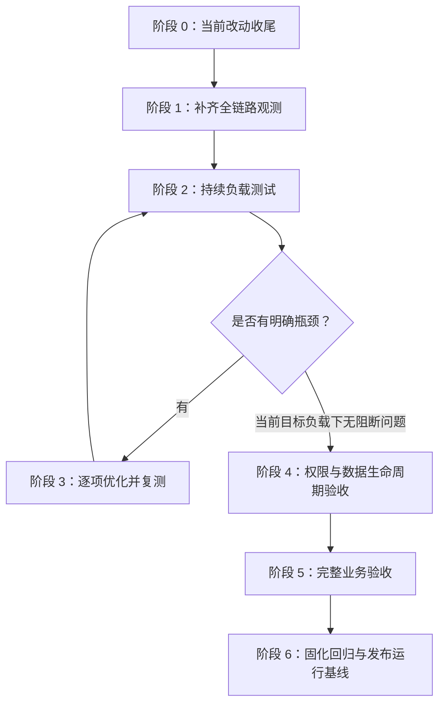

# RAG 后续迭代执行路线

> 更新日期：2026-11-24。本文是后续工作的执行入口；每完成一个阶段，更新进度、结果链接和下一步。技术设计与实验细节保留在对应专题文档中。

## 1. 当前在哪里

本轮目标：在已有问答质量基础上，把系统做到运行稳定、问题可定位、改动可回归。先完成当前主线，再安排新的产品能力。

| 业务链路                      | 当前结论                   | 后续处理                                    |
| ----------------------------- | -------------------------- | ------------------------------------------- |
| 上传 → 解析 → 发布 → 建立索引 | 已有实现与相关测试         | 在阶段 4、5 组合验收，不重新设计整条链路    |
| 召回与合并                    | 已完成阶段性优化与评测     | 保留当前方案；发现新失败样本再定位          |
| BGE 重排                      | 已完成阶段性优化与模型对照 | 保留当前方案及并发准入                      |
| 上下文 → 生成 → 引用校验      | 已完成阶段性优化与回归     | 继续作为质量基线                            |
| 运行可靠性                    | 阶段 1 已完成实现与验证    | 已补齐观测，待阶段 2 持续负载验证；尚未部署 |
| 持续负载、安全与完整业务验收  | 待按本文执行               | 现有专项测试不能代替本轮完整验收            |

“阶段性完成”表示已有证据支持当前方案，并不表示所有场景都已解决。最新改动包括单请求窗口长度分组，以及问答超时、错误分类和有限重试；实现与验证边界见[问答可靠性](answer-reliability.md)、[长度分组与微批处理对照](answer-microbatch-validation.md)。

## 2. 固定执行顺序

阶段 3 是由测试结果触发的工作，不预先承诺增加缓存、排队或扩容。阶段 4、5 发现问题时，在对应模块完成修复和相关回归后，再继续验收。

### 执行看板

| 阶段                      | 状态       | 完成结果                                       |
| ------------------------- | ---------- | ---------------------------------------------- |
| 0：当前改动收尾           | **已完成** | 提交与验证结果见本文收尾记录                   |
| 1：全链路观测             | **已完成** | [验证记录](answer-observability-validation.md) |
| 2：持续负载测试           | **下一步** | —                                              |
| 3：瓶颈优化               | 按实测触发 | 无瓶颈则跳过，并记录原因                       |
| 4：权限与数据生命周期验收 | 待执行     | —                                              |
| 5：完整业务验收           | 待执行     | —                                              |
| 6：回归与发布运行基线     | 待执行     | —                                              |

## 3. 每个阶段具体怎么做

### 阶段 0：收尾当前改动

**要回答的问题：已有成果是否清晰、可审查、可回退？**

- [x] 审查当前分支全部改动，按职责核对代码、测试与文档。
- [x] 保留维护所需测试和正式结论，排除原始报告、临时脚本、草稿、生成文件和密钥。
- [x] 核对已有验证记录；若代码再修改，补跑受影响测试及项目要求的检查。
- [x] 提交后记录提交号、验证结果，以及运行环境是否已生效；合并与发布状态分别记录。

**完成标准：**形成可回退的提交基线，明确哪些代码已验证、哪些环境已生效。通过测试不等于已经部署。

### 阶段 1：补齐全链路观测

**要回答的问题：一次回答慢、失败或质量回退，能否找出原因？**

- [x] 用统一请求标识关联召回、重排、上下文、生成、引用校验及最终结果。
- [x] 补齐分阶段耗时，特别区分召回内部、BGE 推理与模型调用，避免将多个阶段混成一个耗时。
- [x] 记录实际重排路径和回退原因，区分繁忙、超时、服务不可用等情况。
- [x] 记录每次模型调用的耗时、结果、传输恢复、引用修正和 Token 用量；缺失用量标为未知，不当作零。
- [x] 提供可复用的汇总入口，输出成功率、错误分布、P50/P95、回退率和用量；优先复用现有日志与观测设施。
- [x] 验证观测关闭、上报失败和正常启用时，业务结果保持一致；日志中不包含密钥。

**完成标准：**抽取一条正常请求、一条降级请求和一条故障请求，都能关联到具体阶段与原因。Token 用量只代表服务返回的统计，费用需结合实际计价核对。

已有基础见[可观测性设计](observability.md)与[问答可靠性](answer-reliability.md)。本阶段补齐缺口，不重复建设已有记录。

### 阶段 2：持续负载测试

**要回答的问题：当前环境长时间使用时，在哪个负载开始变慢、降级或丢失证据？**

- [ ] 测试前固定代码、模型、配置、硬件、语料与计分规则，声明运行时长、请求到达方式和停止条件。
- [ ] 先复测单请求质量基线，再做 1/2/4/8 并发与持续到达测试，区分波次并发和持续负载。
- [ ] 混合短问题、长证据、多来源、无答案和冲突问题，避免只测容易回答的样本。
- [ ] 同时检查答案正确性、必要证据覆盖、引用支持、拒答、错误率、P95、回退率、用量和资源变化。
- [ ] 检查持续运行后内存、未完成请求与连接是否累积；停止发压后观察能否恢复。
- [ ] 在隔离环境完成受控故障测试，区分本地故障注入与真实外部模型服务结果。

**完成标准：**交付一份容量报告，明确质量可以维持的负载范围、退化起点、瓶颈证据和未验证边界。测试前声明目标，不能看完结果再改标准；若需要用户决定延迟与质量取舍，列出实测数据。

已有[并发基线](answer-concurrency-validation.md)采用有限波次，不能直接推导生产 QPS。后续测试必须使用最新采用代码。

### 阶段 3：根据瓶颈逐项优化

**要回答的问题：哪项修改确实改善了当前瓶颈，代价是什么？**

| 实测问题               | 可评估方向                               | 必须一起检查                       |
| ---------------------- | ---------------------------------------- | ---------------------------------- |
| BGE 繁忙导致证据回退   | 资源隔离、部署扩容；有新依据时再评估调度 | 证据覆盖、回退率、尾延迟、资源成本 |
| Embedding 耗时明显增长 | 排查模型运行时与资源争用                 | 召回质量、耗时和资源使用           |
| 外部生成慢或限流       | 核对实际超时与恢复效果，评估请求准入     | 成功率、质量、等待时间、额外调用   |
| 用户断开后仍有无效工作 | 取消信号传播与可中止资源清理             | 是否停止后续调用、资源是否释放     |
| 重复计算占比高         | 在权限与版本边界明确后测试缓存           | 命中收益、失效、越权与旧内容风险   |

- [ ] 每次只验证一个主要假设，保留原失败样本与正常对照。
- [ ] 有效果则采用；无效果则删除实验性业务逻辑，记录结论。
- [ ] 有明显质量、速度或成本取舍时，交给用户决定。
- [ ] 采用后回到阶段 2 复测，确认没有将瓶颈转移成更严重的问题。

**完成标准：**目标负载下的阻断问题解决，或用户明确接受剩余限制；不要求穷尽所有可能优化。

### 阶段 4：权限与数据生命周期验收

**要回答的问题：文档和权限变化后，用户是否仍只看到当前有权访问的有效内容？**

- [ ] 覆盖不同身份与可见范围，检查检索、上下文、答案、引用及来源访问。
- [ ] 覆盖文档更新、撤回、删除与权限调整，验证旧内容何时退出消费路径。
- [ ] 在问答期间切换发布版本或权限，检查变化时点与结果是否符合既有一致性合约。
- [ ] 覆盖 Outbox/RabbitMQ 延迟、重复投递和失败恢复，验证索引不会错误激活旧版本。
- [ ] 若后续引入缓存，额外验证权限和版本变化后的失效。

**完成标准：**无权内容与失效版本不越过既定可见性边界；异步延迟、在途请求语义和修复结果有明确记录。已有专项测试先复用，仅补缺口。

### 阶段 5：完整业务验收

**要回答的问题：从用户上传文档到获得答案，整条操作是否完整可用？**

- [ ] 上传 → 解析 → 审核发布 → 索引激活 → 提问 → 查看引用，跑通真实接口与前端操作。
- [ ] 按项目支持范围选择代表性文件格式，检查解析内容能否正确进入问答。
- [ ] 检查多来源回答、无答案、冲突、无权限和文档更新后的行为。
- [ ] 检查处理中、失败、超时、重试和来源不可访问时的前端反馈。
- [ ] 使用新来源与新问题做二次检查；已看过的题继续算回归，合成题不宣称为独立人工验收。

**完成标准：**核心业务流程走通，失败有明确反馈，答案与引用符合约定；剩余问题按影响列明并处理。

### 阶段 6：固化回归与发布运行基线

**要回答的问题：下次修改能否知道退步了，上线后能否定位和恢复？**

- [ ] 整理快速回归与完整验收两类入口，保留可复现的语料、计分口径与必要失败样本。
- [ ] 将稳定、成本可控的检查纳入现有自动化流程；真实模型测试单独标明依赖、用量和波动。
- [ ] 记录部署配置检查、健康检查、索引兼容要求、冒烟步骤与回退方法。
- [ ] 基于阶段 2 数据确定运行基线和告警阈值，避免凭空规定生产容量。
- [ ] 发布后做受控冒烟，并分别记录提交、合并、部署版本与实际运行结果。

**完成标准：**有可复现的验证入口和可执行的排查、回退步骤，实际运行版本可确认。涉及发布时沿用届时用户授权与环境约束。

## 4. 已确定的边界

- 模型训练暂不做；召回、重排、生成模型不因进入新阶段而自动重选。
- 保留现有 BGE；保留既有并发准入，采用单请求窗口长度分组。
- 有界排队与跨请求微批处理此前未采用，本路线不会自动将其开启。历史依据见[排队对照](answer-queue-validation.md)、[微批处理对照](answer-microbatch-validation.md)。
- 缓存、复杂调度、扩容由实测瓶颈触发；工作台、图谱工作室等新功能另列后续产品计划。
- 当前 45 秒整次期限与 30 秒模型单次期限是工程预算，后续可依据实测调整，不宣称已经最优。

## 5. 每次完成后怎样更新

每次只推进当前阶段的明确任务。新问题归入对应阶段；若阻断当前任务，说明原因后调整顺序。

统一汇报四项：**测了什么、结果如何、采用或丢弃什么、哪些取舍需要用户决定。** 阶段结束时填写下表并更新执行看板。

| 日期       | 阶段 / 任务                    | 测试与结论链接                                 | 采用 / 丢弃 / 待决                       | 代码及部署状态                 | 下一步 |
| ---------- | ------------------------------ | ---------------------------------------------- | ---------------------------------------- | ------------------------------ | ------ |
| 2026-11-24 | 路线建立；当前可靠性改动待收尾 | [可靠性验证](answer-reliability.md)            | 已实现，待收尾                           | 当前分支未提交；未重启生效     | 阶段 0 |
| 2026-11-24 | 阶段 0 收尾完成                | 本文收尾记录                                   | 保留长度分组与有限恢复；排队、微批未采用 | 已本地提交；未推送、合并或部署 | 阶段 1 |
| 2026-11-24 | 阶段 1 全链路观测完成          | [验证记录](answer-observability-validation.md) | 观测接入与异常隔离通过                   | 本地提交；未推送、合并或部署   | 阶段 2 |

### 阶段 0 收尾记录（2026-11-24）

- **代码基线：**分支 `codex/answer-concurrency-baseline`，起点 `b15d938`；`970b333` 提交 BGE 单请求长度分组及正式实验结论，`991c22a` 提交问答期限、故障分类、有限恢复、维护测试和执行路线。后续文档提交记录本次收尾状态。
- **职责审查：**批次规划、模型适配、执行期限、传输恢复、故障分类与 HTTP 映射分别独立；问答应用服务协调流程。本次审查未发现需要进一步拆分的新增业务职责。
- **重新验证：**先通过 60 项聚焦测试，再通过 API 78 个文件 / 443 项、Web 11 项、Node 评测工具 49 项、Python 重排 16 项测试；前后端构建、编译后重排模块与问答控制器 HTTP 冒烟均通过。
- **交付检查：**主 Compose 及三份隔离 Compose 合并配置、修改文件格式、本地文档链接、Git 差异检查通过；提交清单未包含环境文件、密钥、构建产物或原始实验报告。必要的维护测试与正式结论保留。
- **运行状态：**已本地提交，未推送、未合并到 main、未重启或部署。前端构建仍有既有大包提示；本阶段未重跑真实 DeepSeek 质量评测或持续负载测试，13 项 HTTP 故障注入使用本机模拟上游。

### 阶段 1 完成记录（2026-11-24）

请求编号、分阶段耗时、BGE 回退原因、逐次模型用量、恢复/修正计数与日志汇总已接入；观测故障隔离、并发隔离和迟到结果处理验证通过。详细范围与边界见[阶段 1 验证](answer-observability-validation.md)，不以日志统计替代答案质量评测。

API 477 项、Web 11 项、Node 评测工具 49 项、观测工具 4 项和 Python 16 项测试，以及前后端构建与配置检查通过。编译产物的三次受控 HTTP 检查实现响应头、实际日志与汇总对照。本阶段代码本地提交，尚未推送、合并或部署；未开始阶段 2 发压。

**当前下一步：阶段 2，先固定测试协议，再进行持续负载测试。**
