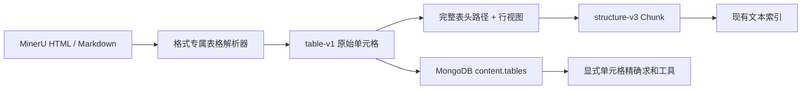

# 表格证据、分块与精确计算

## 问题与本次边界

真实 MinerU 4.2.3 Flash 对合并单元格返回 HTML，保留 `rowspan`、`colspan` 和多层表头。`5cd4549` 的分块器只把 Markdown 表格识别为表格，HTML 被按普通段落切分；行内数字可能还在，但表头和对应行不一定留在同一块。这个问题发生在解析之后，切换解析引擎本身不会解决。

本次实现 HTML/Markdown 表格的结构产物、检索用行视图、持久化与来源契约。没有增加自然语言表格查询端点，也没有改动召回、重排或 Prompt。跨页续表、原生 Excel 公式/缓存结果、可信单位类型、视觉表格识别质量仍是独立工作，不能以此次结果宣称已解决。

## 两种表示，分别承担定位与计算



`table-v1` 的每个单元格保存表内一基行列、行列跨度、原始可见文本、表头标记及可用的 scope。单元格来自 HTML 解码后可见文字或 Markdown 解转义后的文字；不自动把 `001.20 万元` 解释为数值，也不把空白改成 0。原始文件、完整 Markdown 与 MinerU 原始 JSON 继续保留。每个 HTML anchor 单元格只存一次，合并覆盖的位置不新增数值单元格。

检索视图将同一列的各级表头用 `/` 串联，并在每个 Chunk 重复表头。合并的数据标签可在覆盖行中重复，保持逐行语境；这些重复项是派生文本，不能作为汇总计算输入。表内 caption 进入检索上下文，代码围栏内的表格文字保持原样。完整行无法装入预算时明确报错，不截断单元格。

表 ID 是原始表格文本及所在 Markdown 起点的摘要；身份由 `documentId + contentId + tableId` 共同确定，不能把 tableId 当全局权限标识。表格产物包含 Markdown 的 start/end 和已有的页/幻灯片/partition/bbox 来源。Chunk 新增 `tableId`、`tableRowStart`、`tableRowEnd`，行号是表内逻辑行，不是 Excel 行号；HTML/Office 的 partition 也不能冒充原文件页号或 sheet 名。

MongoDB 中 `tables` 保存唯一的结构对象，`blocks` 仅保存 `tableId` 引用，避免重复复制单元格。文档详情在读取正文时返回 `tables`；原有用户访问检查先于正文读取。前端 API 类型已补齐，本次没有新增表格核对界面或自动让检索引用 UI 展示新元数据。

`sumTableCells` 是独立、可测试的底层工具，输入必须是明确的原始单元格坐标，返回十进制字符串及参与的坐标。通过 BigInt 定点运算避免浮点累加误差；拒绝表头、重复坐标、合并覆盖位置、缺失值、百分比、单位、公式和歧义数字。允许符号和规范千分位，最多 100 位整数、18 位小数。不自动筛选“所有预算”，不推断相同单位，也不重新执行 Excel 公式；调用端还需绑定文档权限与修订，尚未接入问答工具调用。

## 失败、预算与存量数据

- 格式解析器只做静态解析，不执行脚本、加载 URL 或计算公式。HTML 标签边界由 tokenizer 识别，注释、属性、脚本里的 `</table>` 不会误截断表格。
- 嵌套表、跨度重叠/越界/跨行组、`rowspan=0` 等当前不支持的结构明确失败，保留原文件供重新处理；不猜测或默默丢弃。Markdown 列数不一致也明确失败。合法但尚未支持的表格可能因此需要人工整理或后续适配。
- 每张表最多 4,194,304 个 UTF-16 字符、10,000 行、256 列、100,000 个占用格及展开网格格位。MongoDB 完整 BSON 记录另限 15 MiB，为其 16 MiB 硬限制留余量；不因结构化膨胀向数据库提交超限记录。
- 不支持的表格导致解析不 READY；解析中已上传的资源走既有补偿清理。持久化失败继续由既有正文提交/任务协议处理，不激活不完整版本。
- 分块策略升级到 `structure-v3`，旧 Chunk 缓存自动失效；旧正文仍可从 Markdown 重建 Chunk。存量正文不会因此自动多出持久化 `tables`，需要重解析或保存新修订。手工修改后重算表格，来源不继承旧文件的精确位置。

## 真实 MinerU 对比

2026-11-23，4 个合成 HTML 文件各请求真实 MinerU 4.2.3 Flash Tasks API 3 次，共 12 次。每次的相同解析结果分别输入 Git `5cd4549` 和当前分块器；字符预算均为 130、overlap 为 0，刻意覆盖小预算下的结构切分。基线通过临时转译真实 Git 源码加载，没有重写旧行为，也未改动工作区文件。

指标为“同一个 Chunk 同时包含一条数据行所有非空值与全部表头标签”。两边使用相同字符串条件；该指标说明上下文保留，不等于语义检索或问答准确率。额外检查规范单元格的所有值、坐标、跨度、表头行及表内定位，逐格与原始夹具比较。

| 样本                     | 每轮旧版完整上下文行 | 每轮新版完整上下文行 | 原始单元格数 | 旧/新 Chunk 数 | 明确选定单元格的和 |
| ------------------------ | -------------------: | -------------------: | -----------: | -------------: | -----------------: |
| 多层表头、合并部门       |                  0/3 |                  3/3 |           12 |          4 / 1 |                335 |
| 合并数字、负数、零与空值 |                  0/5 |                  5/5 |           11 |          3 / 1 |              10.25 |
| 24 行普通长表            |                24/24 |                24/24 |           50 |          5 / 5 |              24300 |
| 24 行多层表头、合并分组  |                 0/24 |                24/24 |           64 |        14 / 12 |              72600 |

三轮结果一致；普通表格已有完整表头分块，不能声称所有表格都有提升。合并数字 `12.50` 在检索文本中出现两行，但计算只选择其原始位置一次；选择覆盖位置或空白单元格会失败。所有生成 Chunk 未超预算，所有数据行都有表内行号及原解析块来源。

本次只验证静态 HTML 的真实解析和表格后处理，不覆盖 PDF/扫描图表格、跨页续表、复杂 Excel 公式、OCR 字符错误或生产语料。资产上传使用内存替身；MongoDB 存储、缓存命中及删除另由真实 Mongo 集成测试覆盖。未调用 embedding 或生成模型，不宣称检索/回答质量提升。

最终回归：API 329 项、Web 220 项单元测试通过；真实 Mongo 持久化 6 项、异步解析任务 6 项、原生格式语料 2 项通过；API/Web 构建、变更源码与文档格式、Compose 配置及 diff 检查通过。首次 Mongo 测试因 Registry 请求超时未能启动，使用已有镜像重跑后 6 项通过；测试数据库与本地 MinerU 服务已停止，服务临时产物不进入提交。

复现命令（固定 MinerU 版本，提前启动本地服务）：

```bash
MINERU_BASE_URL=http://127.0.0.1:8000 pnpm --filter @knowbase/api benchmark:tables
pnpm --filter @knowbase/api test:ingestion
```

逐轮摘要、版本、耗时、完整上下文行数、定位和求和值写入忽略的 `reports/ingestion-tables/comparison.json`。解析请求约 1 秒，受轮询间隔影响；本次不以毫秒级分块耗时宣称性能收益。若 Docker Registry 不可用但本机已有测试镜像，可给集成测试设置 `DELIVERY_TEST_PULL_POLICY=never`。
